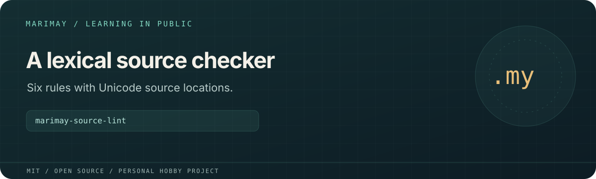

# marimay-source-lint



> **Personal learning project.** This open-source MIT project is part of
> [Marimay](https://github.com/marimay-lang/marimay), my hobby programming-language project.
> I maintain it in my spare time to learn by building. APIs and tooling may
> change, and progress may be intermittent.

A lexical checker for trailing whitespace, indentation tabs, TODO/FIXME comments, unfinished lexical contexts, missing final LF and lone CR characters.

**Status:** Experimental Marimay learning application. Process acceptance scripts exercise
VM and native Debug/Release execution. Full platform and performance acceptance
remain in progress; existing reports retain their recorded revisions and limits.

## Run and verify

```sh
mmay run . -- --help
mmay run . -- --json - < fixtures/sample.my.txt
mmay run . --allow-read fixtures -- fixtures/clean.my.txt
mmay fmt . --check
mmay check .
mmay test . --engine both
MMAY="$(command -v mmay)" python3 tools/acceptance.py
mkdir -p build
mmay build . --release --output build/app
```

Install a compatible `mmay` and use its matching standard library. Application
arguments follow `--` in `mmay run`. Filesystem and environment access requires
explicit grants; native grants are selected at build time.

The scanner tracks literals, nested block comments and interpolation. Findings
include UTF-8 byte spans and one-based line/Unicode-scalar columns. It provides
lexical checks without type checking or automatic edits. Input/output and
finding counts are bounded; `-` selects stdin and `--json` selects JSON output.

Python generates synthetic inputs and drives independent process checks;
application logic is written in Marimay. `MMAY=/absolute/path/to/mmay` selects
the compiler for Python drivers. `python3 tools/measure.py` runs the existing
measurement harness and writes local reports under `build/`.

See [`BUDGETS.md`](BUDGETS.md), [`ERGONOMICS.md`](ERGONOMICS.md), [`VERIFICATION.md`](VERIFICATION.md) for project-specific budgets,
findings and historical verification details.

## License

[MIT](LICENSE). Existing copyright attribution is retained.
